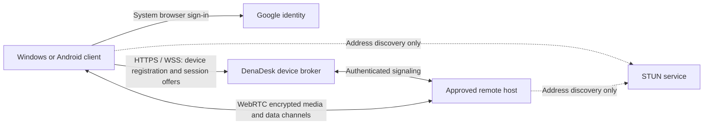

# DenaDesk remote access: setup design

Status, 2 November 2026: Windows 2.8.0 source implements Google desktop sign-in, device linking, pinned Ed25519 device keys, signed connection setup, per-session host approval, direct WebRTC screen viewing and optional keyboard/mouse control. A real Electron integration test decoded screen video, verified a direct selected ICE pair, exercised Shift + A and disconnected both endpoints. Separate-network field testing remains required. Android account linking, system sound, clipboard/files and unattended Internet sessions are not included in this milestone. Local pairing and USB continue to work without an account.

Owner requirement: remote-session traffic travels directly between host and guest. Google identifies the account used to list linked devices. The DenaDesk broker stores device records and exchanges connection-setup messages; device trust is approved and stored on each PC. The broker never forwards screen, audio, input, clipboard or file traffic. No Cloudflare setup or TURN relay is part of this design.

## Using the Windows milestone

1. On each Windows PC, open General → Google account, import the same owner's Desktop OAuth configuration, and sign in using the system browser. Importing configuration does not sign in or enable hosting.
2. Click **Link this PC** on both computers. This is an explicit opt-in; a Google login alone does not enable remote access. Each PC publishes its name and public device key to the account's device list.
3. Click **View** or **Control** beside an online PC. When asked to trust a new device, compare every group of the fingerprint against **This device fingerprint** displayed on the other PC. Both ends must approve first-time trust. Subsequent connections still need the host's session approval.
4. The host explicitly approves sharing its primary display, with keyboard/mouse control only when requested. A visible sharing window remains open. Close either session window, click Disconnect in General, lock the PC, unlink it or forget that peer's trust to end the session. Minimize the main app without ending an approved session.
5. A connection attempt ends after 45 seconds if no direct path is possible. Sessions last at most about one hour before reauthentication/reconnection; no automatic resumption grants control.

The registry writes names, public keys, account subjects and last-seen timestamps atomically to `REGISTRY_FILE` (default `/tmp/denadesk-devices.json`). Render Free has ephemeral storage: a restart or redeployment can lose offline device records, and linked online clients register again. Encrypted device keys and approved peer pins remain on each PC. A durable registry requires a later hosting/storage decision; no paid resource is provisioned by this implementation.

## Connection architecture

Use WebRTC and ICE for direct peer connections, with STUN for public-address discovery. STUN does not relay remote-session traffic. This is a DenaDesk service design; it does not claim compatibility with Google's private remote-desktop signaling service or Chromoting wire protocol. Google sign-in provides identity, not a device registry or remote-desktop tunnel. Reuse the existing local WebRTC and input helpers where suitable, with a separate Internet connection configuration that excludes their existing local TURN settings.

Direct connections cannot be guaranteed across all NATs, carrier networks and firewalls. If ICE cannot establish a direct path, end the attempt with an actionable error; never silently fall back to a relay. A reachable IPv6 route or an owner-configured network change may help. Do not automatically open router ports, weaken firewalls or change network profiles. Render still handles device discovery and connection setup, so this design is not independent of third-party services during sign-in and discovery.

## Owner setup

1. Create a Google Cloud project and configure Google Auth Platform branding, audience and test users. Create a **Desktop app** OAuth client for Windows. Android needs a separate platform client registered with `com.denarmo.denadesk` and the release signing certificate. Desktop client identifiers are public configuration; never treat an installed app's client secret as a security boundary.
2. Use the Render HTTPS hostname for the DenaDesk broker and its authenticated WSS `/v1/link` endpoint. Configure durable registry storage before relying on offline records across restarts. Keep secrets in the hosting provider's secret store. Start with one region and bounded session/message limits.
3. Configure STUN address discovery without TURN credentials or relay URLs. Google sign-in does not itself provide the linked-device list; DenaDesk's authenticated registry supplies that list for the verified account.
4. Configure client IDs, broker URL, STUN discovery and token verification audiences. Publish a privacy policy describing device names, public addressing/ICE metadata, account identifiers and retention. Review Google's publication requirements before opening sign-in beyond configured test users.
5. Test two Windows devices on different networks before enabling Android remote viewing. Android screen capture still requires the phone's normal MediaProjection consent and foreground-service behavior. Remote access does not bypass Android permissions or Windows secure desktop/UAC.

## Authentication and device trust

- On desktop use the system browser, authorization code flow with PKCE, a random state and nonce, and a short-lived loopback callback bound only to loopback. Request `openid email`; request profile only if the UI needs it. Do not request Drive/Gmail access. Use the supported Android identity flow for Android.
- The desktop verifies the sign-in transaction's nonce; the broker independently verifies ID-token signature, issuer, audience, expiry and account authorization. Use Google's stable `sub` claim as account identity, rather than email. The WSS connection authenticates a fresh server challenge with the device's Ed25519 private key and a verified Google ID token. Connections expire with that identity, at most one hour; refreshing credentials requires a new challenge. Credentials and private keys stay in OS-protected storage and never enter renderers or logs.
- Generate a per-device key and pin approved peer public keys locally after fingerprint comparison. The device ID is the SHA-256 digest of its Ed25519 public key. Account membership may list devices but must not grant input control. A new peer requires local trust approval on both ends. Every viewing/control session requires fresh host consent. Remote linking starts disabled.
- Each signed setup envelope binds its version, random session ID, sender/recipient device IDs, sequence, expiry, message kind and capability or SDP/ICE payload. SDP includes WebRTC certificate fingerprints. A signaling-service compromise cannot replace a pinned device key or forge its signed SDP. Reject replay, revoked devices, mismatched accounts and unexpected fingerprints. Initial trust requires comparing the other PC's locally displayed fingerprint; skipping that comparison removes the first-contact identity protection.
- Ask the host to approve viewing/control, show the remote peer and a persistent session indicator, and provide immediate disconnect and per-device revocation. Treat unattended access as a separate future opt-in feature. Revocation terminates active sessions and expires device tokens.

## Session setup and application integration

1. A signed-in client registers its public device key and minimal capability/presence record. The broker returns only devices authorized for that account/controller.
2. The controller requests a capability-scoped session (view, input, clipboard or files). The host approves locally and both endpoints verify the signed session transcript.
3. Exchange SDP and trickled ICE candidates over the broker. Configure no TURN URLs; reject relay candidates in local and remote signaling and check the selected candidate pair before allowing session traffic. Accept only a direct peer connection. Encrypt media with WebRTC SRTP and data channels with DTLS. Signaling and STUN expose connection metadata, but receive no remote-session content. Keep candidate filtering in the main-process signaling boundary as well as the peer-connection code.
4. Bridge the approved channels into the existing native capture/input and file APIs with bounded queues, frame-rate/bitrate limits, input-release handling and backpressure. Separate interactive input from bulk transfers. Keep session ownership in the main process so minimizing the UI cannot terminate it.
5. On disconnect, timeout, host lock or revocation, release held input and close streams promptly. Reconnection requires a valid authorization, never a blind replay of an earlier session. If a direct path is unavailable, display that reason and end the attempt; linked-device visibility does not guarantee reachability.

## Delivery stages and acceptance checks

The first implemented milestone includes device linking and Windows viewing/control. Next validate real computers on separate networks, then add optional sound, clipboard/files and Android viewing with normal on-device consent. Keep unsupported features explicitly labeled and do not enable unattended control implicitly.

Acceptance requires direct sessions across separate networks and explicit failure when restrictive NAT or firewalls prevent them. Test IPv4/IPv6 paths, network switches, expired credentials, lost signaling, revoked peers, host lock, minimize-to-tray, and stale held Shift/mouse buttons. Inject relay candidates and verify rejection; check selected candidate pairs and network captures to confirm that session traffic flows only between peers. Verify that another account cannot enumerate devices, unauthorized signaling cannot request input, and a compromised broker cannot swap pinned keys. Measure peer bandwidth, broker metadata volume and idle resource use before public deployment.

## Primary references

- [Google OAuth for desktop apps](https://developers.google.com/identity/protocols/oauth2/native-app): installed-app authorization and PKCE.
- [WebRTC peer connections](https://webrtc.org/getting-started/peer-connections): ICE servers, peer connections and application-defined signaling.
- [Chromium remoting transport architecture](https://chromium.googlesource.com/chromium/src/+/refs/heads/main/remoting/protocol/GEMINI.md): WebRTC transport, authentication and signaling in Chrome Remote Desktop.
- [Android audio sources](https://developer.android.com/reference/android/media/MediaRecorder.AudioSource): cellular call audio capture requires system-only privileges; this design does not enable cellular PC microphone/speaker calling over USB or Wi-Fi.
