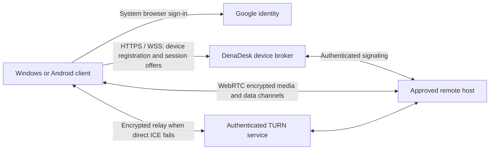

# DenaDesk remote access: setup design

Status: proposed setup, 2 November 2026. No Google account is connected and no cloud service is deployed by this release. Local pairing and USB continue to work without an account.

## Connection architecture

Use WebRTC, ICE, STUN and TURN for transport, as Chrome Remote Desktop does at the transport level. This is a DenaDesk service design; it does not claim compatibility with Google's private remote-desktop signaling service or Chromoting wire protocol. Google sign-in provides identity, not a remote-desktop tunnel. The existing local WebRTC and input helpers can be reused, but their LAN signaling and loopback TURN configuration are insufficient for Internet access.

## Owner setup

1. Create a Google Cloud project and configure Google Auth Platform branding, audience and test users. Create a **Desktop app** OAuth client for Windows. Android needs a separate platform client registered with `com.denarmo.denadesk` and the release signing certificate. Desktop client identifiers are public configuration; never treat an installed app's client secret as a security boundary.
2. Register an owned HTTPS hostname for a DenaDesk broker. Deploy a small authenticated HTTPS/WSS service with a persistent device registry, expiring presence records and session-offer delivery. Keep secrets in the hosting provider's secret store. Start with one region and bounded session/message limits.
3. Deploy an authenticated TURN server on a public host, with a dedicated hostname and TLS certificate. Configure UDP and TCP relay connectivity and a TLS 443 fallback where feasible. Provision short-lived TURN credentials from the broker only after session authorization. Restrict relay destinations, allocations, bandwidth and credential lifetime. Budget for relay traffic; no paid infrastructure is enabled by this document.
4. Configure client IDs, broker URL, TURN host and token verification audiences. Publish a privacy policy describing device names, public addressing/ICE metadata, account identifiers and retention. Review Google's publication requirements before opening sign-in beyond configured test users.
5. Test two Windows devices on different networks before enabling Android remote viewing. Android screen capture still requires the phone's normal MediaProjection consent and foreground-service behavior. Remote access does not bypass Android permissions or Windows secure desktop/UAC.

## Authentication and device trust

- On desktop use the system browser, authorization code flow with PKCE, a random state and nonce, and a short-lived loopback callback bound only to loopback. Request `openid email`; request profile only if the UI needs it. Do not request Drive/Gmail access. Use the supported Android identity flow for Android.
- The broker verifies ID-token signature, issuer, audience, expiry and the transaction's nonce. Use Google's stable `sub` claim as account identity, rather than email. Exchange successful authentication for a short-lived, device-bound DenaDesk session. Keep any long-lived device credential in OS-protected storage; never in renderer localStorage or logs.
- Generate a per-device key and retain the app's pinned pairing model. Account membership alone may list devices but must not grant input control. Enrolling a new controller requires explicit approval on the host (or an already trusted local enrollment path). Remote hosting starts disabled.
- Bind each session offer, peer keys, requested capabilities and WebRTC certificate fingerprints to signed session transcripts with nonces and expiry. A signaling-service compromise must not silently substitute a remote peer. Reject replay, revoked devices, mismatched accounts and unexpected fingerprints.
- Ask the host to approve viewing/control, show the remote peer and a persistent session indicator, and provide immediate disconnect and per-device revocation. Treat unattended access as a separate future opt-in feature. Revocation terminates active sessions and expires device tokens and TURN allocations.

## Session setup and application integration

1. A signed-in client registers its public device key and minimal capability/presence record. The broker returns only devices authorized for that account/controller.
2. The controller requests a capability-scoped session (view, input, clipboard or files). The host approves locally and both endpoints verify the signed session transcript.
3. Exchange SDP and trickled ICE candidates over the broker. Try a direct WebRTC path first, then use short-lived TURN credentials if needed. Encrypt media with WebRTC SRTP and data channels with DTLS. The relay transports encrypted payloads; signaling still exposes connection metadata.
4. Bridge the approved channels into the existing native capture/input and file APIs with bounded queues, frame-rate/bitrate limits, input-release handling and backpressure. Separate interactive input from bulk transfers. Keep session ownership in the main process so minimizing the UI cannot terminate it.
5. On disconnect, timeout, host lock or revocation, release held input and close streams promptly. Reconnection requires a valid authorization, never a blind replay of an earlier session.

## Delivery stages and acceptance checks

First deliver account/device enrollment and view-only Windows sessions; then input and optional clipboard/files; then Android viewing with normal on-device consent. Do not add a sign-in button that appears operational before the backend exists.

Acceptance requires direct and forced-relay sessions across separate networks, restrictive NAT, network switches, expired credentials, lost signaling, revoked peers, host lock, minimize-to-tray, and stale held Shift/mouse buttons. Verify that another account cannot enumerate devices, unauthorized signaling cannot request input, and a compromised broker cannot swap pinned keys. Measure relay bandwidth and idle resource use before public deployment.

## Primary references

- [Google OAuth for desktop apps](https://developers.google.com/identity/protocols/oauth2/native-app): installed-app authorization and PKCE.
- [WebRTC peer connections](https://webrtc.org/getting-started/peer-connections): ICE servers, peer connections and application-defined signaling.
- [Chromium remoting transport architecture](https://chromium.googlesource.com/chromium/src/+/refs/heads/main/remoting/protocol/GEMINI.md): WebRTC transport, authentication and signaling in Chrome Remote Desktop.
- [Android audio sources](https://developer.android.com/reference/android/media/MediaRecorder.AudioSource): cellular call audio capture requires system-only privileges; this design does not enable cellular PC microphone/speaker calling over USB or Wi-Fi.
